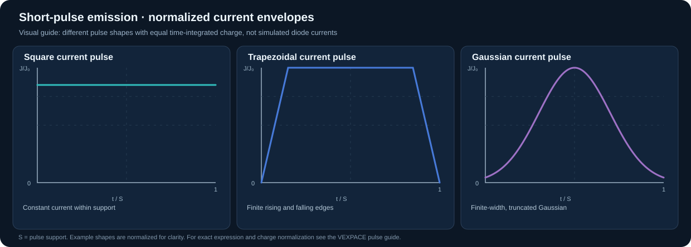
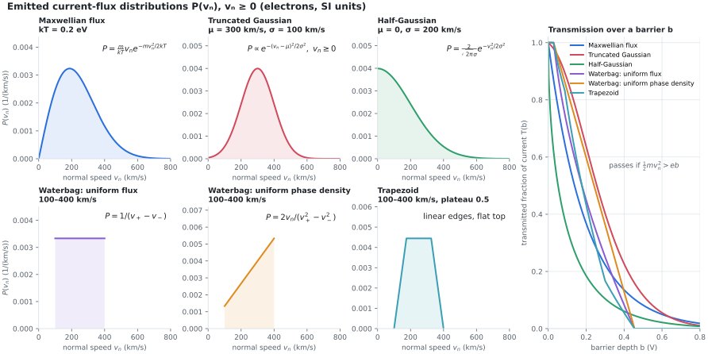

# Short pulses, beam injection and velocity distributions

This guide explains how to create **short electron pulses** and choose supported particle velocity distributions in VEXPACE. It describes features available in the current software; arbitrary user-supplied velocity PDFs are **not yet** implemented.



## 1. Where to enter a short pulse

1. Open **File → Examples** and choose a `short_pulse_*.pic.json` model, or create an **electrostatic** diode.
2. Select **Emission** and set **Emission model = beam**.
3. Enter **Current density J(t) [A/m²]** using a time expression. Set **Start time** and **Stop time** to cover the pulse support.
4. Under **Parameters**, define `Jamp`, `tau`, `support`, `ramp_fraction` or `sigma_t` as required.
5. Set **Beam / excess energy [eV]** and **Emission temperature [eV]**. Use zero temperature for a cold prescribed-energy beam.
6. In **Study / Solver**, choose a sufficiently small `dt`; inspect **Output** histories for injected and collected currents and reflection.

**Important:** `t` is the solver time in seconds. The emitter samples `J(t)` per step; the supplied short-pulse examples use `t+sample_dt/2` as their midpoint sampling convention.

## 2. Copyable current profiles

The following expressions use the same evaluator syntax as VEXPACE. Define all variables in **Parameters**. The current density is in A/m².

### Square pulse

Set `support=tau`, `pulse_area_time=support`, and `Jamp=pulse_charge_per_area/pulse_area_time`.

```text
Jamp*where((t>=0)&(t<support),1,0)
```

This turns current on abruptly, holds it constant, then switches it off. Use sufficiently fine timesteps to resolve the rising and falling boundaries.

### Trapezoidal pulse

Set `ramp_fraction=0.15`, `support=tau/(1-ramp_fraction)`, `pulse_area_time=support*(1-ramp_fraction)`, and `Jamp=pulse_charge_per_area/pulse_area_time`.

```text
Jamp*max(0,min(1,min(t/support,1-t/support)/ramp_fraction))*where((t>=0)&(t<support),1,0)
```

The two ramps each occupy `ramp_fraction*support` and the flat top occupies `(1-2*ramp_fraction)*support`. This is the *temporal current* envelope, not an energy distribution.

### Truncated Gaussian pulse

Define `tau` as the intended **full width at half maximum**, `sigma_t=tau/(2*sqrt(2*log(2)))`, `gaussian_cutoff_sigma=2.5`, `support=2*gaussian_cutoff_sigma*sigma_t` and `pulse_area_time=sigma_t*sqrt(2*pi)*0.9875806693484477`. The retained fraction applies **only** for the displayed cutoff of 2.5 standard deviations. Set `Jamp=pulse_charge_per_area/pulse_area_time`.

```text
Jamp*exp(-0.5*((t-support/2)/sigma_t)**2)*where((t>=0)&(t<support),1,0)
```

For the exact example expressions with midpoint sampling, `sample_dt` and dynamic pulse normalization, see [the six short-pulse examples](../examples/SHORT_PULSE_EXAMPLES.md).

### Comparing shapes fairly

Keep the **injected charge per area** constant:

```text
Jamp = pulse_charge_per_area / pulse_area_time
```

The support duration is not necessarily the FWHM. With a Gaussian, current never truly vanishes without an explicit cutoff. Inspect actual collected current separately from injected current.

## 3. Ready-to-run 2025–2026 short-pulse models

These are representative paper-parameter examples, **not exact reproductions of published plots or fitted limiting currents**. Each uses the existing 1D electrostatic PIC solver.

| Model | Pulse | Physical setting |
|---|---|---|
| [2025 diode · Square](../examples/short_pulse_diode_2025_square_1d.pic.json) | Square | 1.5 mm, 30 kV, cold emission |
| [2025 diode · Trapezoidal](../examples/short_pulse_diode_2025_trapezoid_1d.pic.json) | Trapezoid | 1.5 mm, 30 kV, cold emission |
| [2025 diode · Gaussian](../examples/short_pulse_diode_2025_gaussian_1d.pic.json) | Gaussian | 1.5 mm, 30 kV, cold emission |
| [2026 drift · Square](../examples/short_pulse_drift_2026_square_1d.pic.json) | Square | 1 cm drift, grounded plates, 1 keV injection |
| [2026 drift · Trapezoidal](../examples/short_pulse_drift_2026_trapezoid_1d.pic.json) | Trapezoid | 1 cm drift, grounded plates, 1 keV injection |
| [2026 drift · Gaussian](../examples/short_pulse_drift_2026_gaussian_1d.pic.json) | Gaussian | 1 cm drift, grounded plates, 1 keV injection |

These files and the additional assumptions are documented in [SHORT_PULSE_EXAMPLES.md](../examples/SHORT_PULSE_EXAMPLES.md). In particular, the drift cases have unresolved normalization differences relative to the referenced publication; do not describe them as validated exact paper reproductions.

## 4. Particle velocity and energy distributions



**Temporal current shape and injected velocity distribution are separate choices.** A Gaussian *current pulse* does not automatically give Gaussian particle velocities.

| VEXPACE input | Implemented behavior |
|---|---|
| **Emission → beam**, energy = `E0`, temperature = 0 | Prescribed-energy beam without thermal spread |
| **Emission → beam**, temperature = `T_eV` | Gaussian thermal perturbations added to injected momentum components, in addition to a prescribed energy |
| **Particle Loading**, temperature = `T_eV` | Each initial velocity/momentum component uses a Gaussian thermal distribution with drift; the associated 3D speed follows a Maxwell–Boltzmann distribution in the nonrelativistic thermal limit |
| **Particle Loading**, quiet start = on | Quieter Maxwellian-quantile initialization when the code's per-cell particle requirement is met |
| **Emission → thermionic** | Outgoing normal component follows flux-weighted half-Maxwellian sampling; transverse components have thermal Gaussian spreads |
| **Emission → photo** | Uniform sampled excess energy up to the user-entered maximum and Lambertian angular sampling |

### Cold monoenergetic beam

Choose **Emission model = beam**, **Beam / excess energy = 1000 eV**, **Emission temperature = 0 eV**. The injected beam has a prescribed initial energy before acceleration in self-consistent fields.

### Thermal beam (Gaussian component spread)

Choose **Emission model = beam**, set **Beam / excess energy** to `1000` eV and **Emission temperature** to, for example, `0.4` eV. This adds normally distributed random components of characteristic width `sqrt(T_eV * e / m)` to the injected momentum/velocity-like variables. It is not a user-defined arbitrary distribution.

### Maxwell–Boltzmann plasma loading

Under **Particle Loading**, select a species, choose **Temperature [eV]** (for example `0.4`), and set **Drift velocity**. With no drift, each nonrelativistic Cartesian velocity component is Gaussian, and the speed distribution has the Maxwell–Boltzmann form

```text
f_speed(v) proportional to v^2 * exp(-m*v^2/(2*k_B*T))
```

The temperature input here is `k_B*T` **in eV**, not kelvin. This is a plasma loader, not a boundary electron emitter.

### Thermionic emission

Choose **Emission model = thermionic** and set cathode temperature in **kelvin**, work function in **eV**, and Schottky correction as needed. The outgoing normal thermal distribution is *flux weighted*. It must not be confused with a Gaussian centered at zero normal velocity.

### Arbitrary velocity PDFs: not yet implemented

The current GUI does **not** expose a general arbitrary `P(v)`, `P(E)`, bi-Maxwellian, kappa, waterbag, or tabulated-sampling input for **emitted particles**. Do not assume that a temporal expression in **Current density J(t)** changes `P(v)`. Implementing these would require an additional distribution-sampling option in the emission engine, numerical tests, and explicit parameter normalization.

## 5. Diagnostic workflow

1. Plot the source input `J(t)` and check the total injected charge before running.
2. Compare **emitted current** and **collected current**; these need not match during particle transit or reflection.
3. Inspect potential, current history, particle snapshots and phase space.
4. Reduce the timestep and increase particles per cell to check numerical convergence.
5. For distributions, plot injected-particle velocity histograms and compare them with the intended PDF. Do not infer the injected PDF from a downstream beam histogram without accounting for acceleration and filtering.

See also the full [VEXPACE user guide](USER_GUIDE.md), [numerical methods](THEORY.md), and [short-pulse verification notes](../examples/SHORT_PULSE_VERIFICATION.json).
